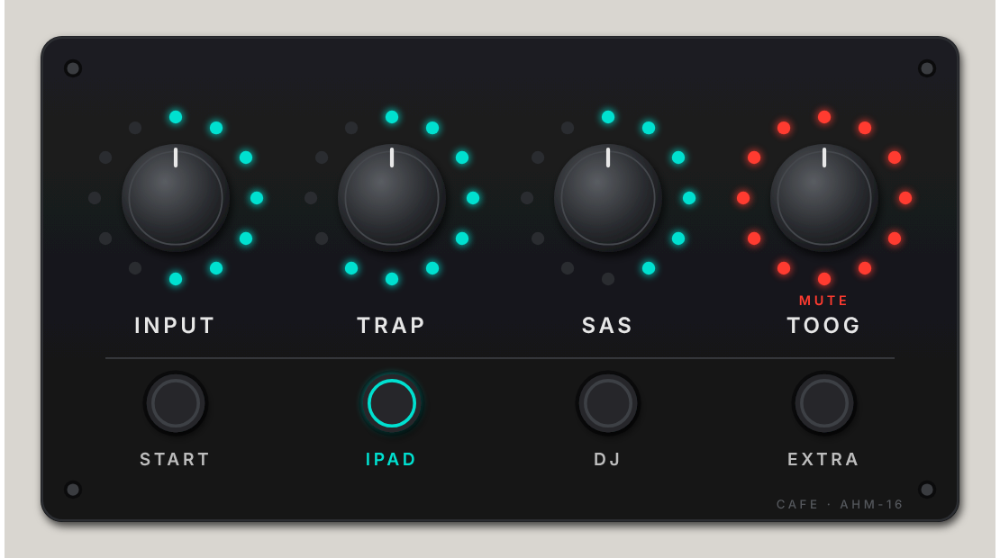
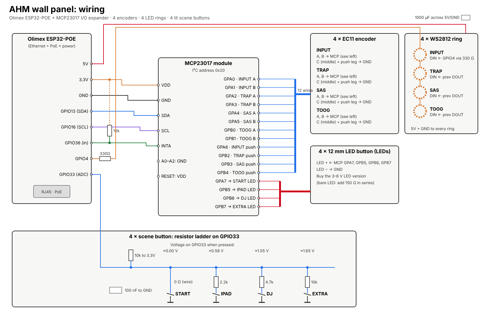

# Custom AHM Wallpanel

A DIY wall controller for an Allen & Heath **AHM-16** (cafe install).

## What it does
- **4 knobs with LED rings**, left to right:
  - INPUT: input level of the active scene (IPAD → input 1, DJ → input 3, EXTRA → input 5)
  - TRAP: control group 1
  - SAS: control group 2
  - TOOG: zone 3
- Turn a knob to change the level. Press it to mute, and its ring turns red.
- **4 lit buttons** recall scenes 1–4: START, IPAD, DJ, EXTRA.
- The panel talks to the AHM over its TCP control protocol (port 51325) and runs on a single PoE network cable.

## Hardware
- Olimex ESP32-POE, an MCP23017 I/O expander, 4 × EC11 encoders, 4 × WS2812 12-LED rings and 4 × 12 mm LED buttons
- See [PARTS-LIST.md](PARTS-LIST.md) (about €47 with an Olimex you already own) and [wiring/WIRING.md](wiring/WIRING.md)

## Enclosure
3D-printable, 170 × 90 mm faceplate on a 35 mm deep surface-mount back box with keyholes for wall screws. See [`3d/`](3d/):
- `faceplate.stl`: print it face-down
- `backbox.stl`
- `labels.stl` (optional): white inlay for multi-material printers
- `ahm-panel.scad`: parametric source. Export a part with `openscad -D 'part="faceplate"' -o faceplate.stl ahm-panel.scad`

The 2D laser-cut file is in `design/faceplate-cut.svg` (1:1 mm, red = cut, blue = engrave).

## Firmware
- `firmware/ahm_test/`: first connection test with 1 encoder (GPIO32/33) and 1 button (GPIO4). Set your AHM's IP address at the top, then build with the board "OLIMEX ESP32-PoE".
- Full panel firmware: to do.

## Test without hardware
[`tools/`](tools/) has a virtual panel for your computer and a fake AHM that prints every command it receives,
so you can check the protocol against System Manager, the real AHM, or nothing at all. See [tools/README.md](tools/README.md).

## Docs
- [docs/ahm-protocol-and-config.md](docs/ahm-protocol-and-config.md): AHM TCP commands and a summary of the cafe show file
