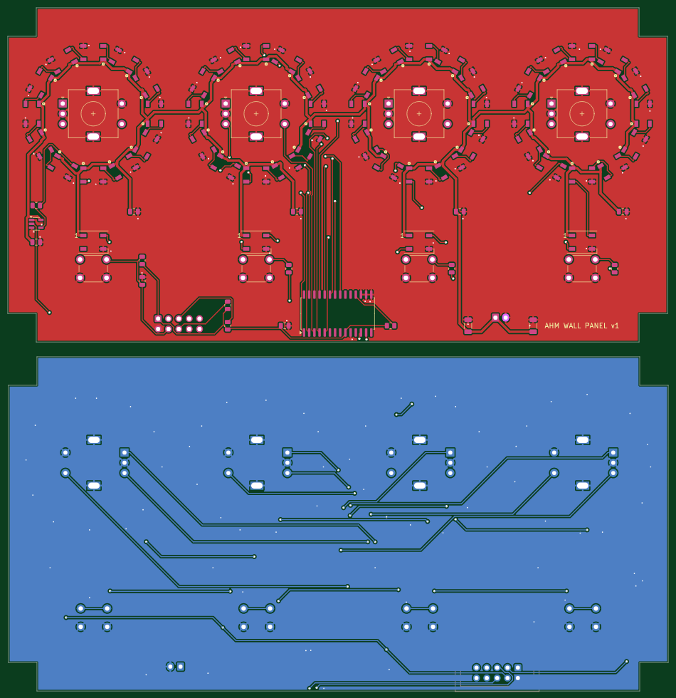
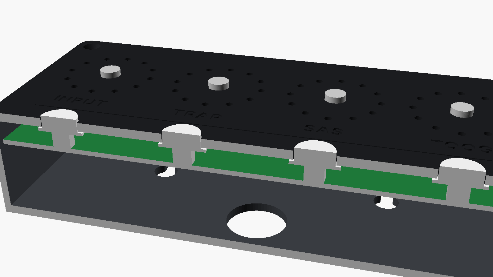

# Panel PCB (v1, untested)

One board that replaces the hand wiring: the 4 encoders, the 4 scene buttons, all 48 ring LEDs, 4 button LEDs and the
MCP23017 sit on it. One 10-wire UEXT cable and one 2-wire 5 V cable go to the Olimex ESP32-POE.



## Fit

- Board 162 x 82 mm with 11 mm corner notches, so it clears the back box walls (1.6 mm) and the screw bosses (1 mm).
- It hangs from the 4 encoder nuts: the PCB front sits 6.5 mm behind the faceplate (the EC11E body height).
  Nothing on the front is taller than the 5 mm tact switches.
- Behind the board there are ~27 mm left for the Olimex and the cables (35 mm box).
- Faceplate for this board: `openscad -D PCB=true -D 'part="faceplate"' 3d/ahm-panel.scad` (`3d/faceplate-pcb.stl`).
  It has light tubes round each LED window so the LEDs don't bleed into each other, and no ring pockets.
- Button caps: `3d/buttoncap.stl`, print 4 in clear/natural PETG. They sit on the switches, flange behind the faceplate,
  and a WS2812B (the same 5050 LED as the rings) under each flange lights the cap.



## Connections

| J1 UEXT (2x5, back) | Olimex | Use |
|---|---|---|
| 1 | 3.3 V | MCP23017, pull-ups |
| 2 | GND | |
| 3 | GPIO4 | LED data (shifted to 5 V on the board) |
| 4 | GPIO36 | scene buttons (resistor ladder, 10k pull-up on the board) |
| 5 | GPIO16 | I2C SCL |
| 6 | GPIO13 | I2C SDA |

J2 (JST XH, back): 5 V and GND for the LEDs, from the Olimex 5 V pin. Check the UEXT pin-out against the Olimex
ESP32-POE schematic before ordering.

Firmware: build with `PANEL_PCB 1` (top of `firmware/ahm_panel/panel_io.h`). That moves the ladder to GPIO36 and drives
the button LEDs as pixels 48-51 of the LED chain.

## Ordering (JLCPCB)

- `production/ahm-panel-gerbers.zip`: 2 layers, 1.6 mm, any colour.
- Assembly, top side only: `production/ahm-panel-bom.csv` + `production/ahm-panel-cpl-top.csv`. Check the LCSC part
  numbers and the LED rotation in JLC's preview before paying (their rotations sometimes differ from KiCad's).
- If JLC has no WS2812B 5050 in its assembly library, untick the LED row and solder the 52 LEDs yourself: the
  white dot on the board marks pin 1 (the LED corner with the notch), which always faces the knob.
- Solder yourself: 4 encoders, 4 tact switches, J1 and J2 (all through-hole, `production/hand-solder.csv`).
  Upload `production/ahm-panel-cpl-jlc.csv` as the CPL.

## Rebuild

```
python3 place.py                      # parts + netlist -> ahm-panel-placed.kicad_pcb, parts.csv
python3 route.py freerouting-2.1.0.jar   # autoroute, GND pours, DRC -> ahm-panel.kicad_pcb, drc.rpt
./export.sh                           # gerbers, drill, placement, BOM -> production/
```

KiCad 7. DRC: 0 unconnected, no copper errors. The remaining warnings are the ring LED courtyards touching (the
pads themselves pass the 0.2 mm clearance check) and library-table notices.
